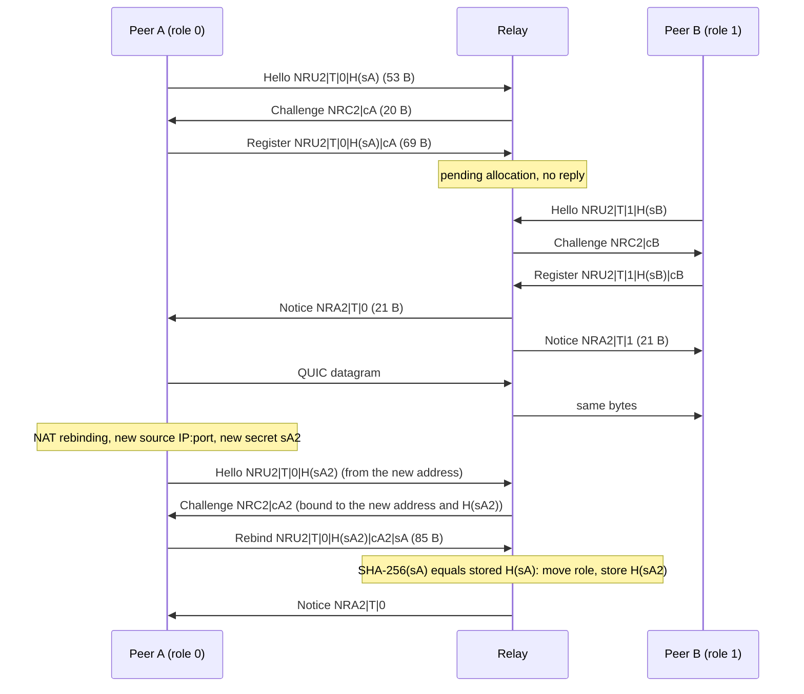

# neutrino-relay

The zero-knowledge relay used by [Neutrino](https://neutrino.peretas.live) file transfers, by [Peretas Technologies](https://peretas.live).

Neutrino connects two computers directly whenever it can: first a direct QUIC connection, then coordinated NAT hole punching. The relay serves two purposes:
1. **Rendezvous.** It lets two peers find each other so they can attempt hole punching.
2. **Last-resort transport.** When no direct path exists, it carries their **end-to-end encrypted** stream.

This repository is the complete server, published so anyone can verify what it can and cannot see, and run their own.

## What the relay sees, and what it never sees

| Sees | Never sees |
|---|---|
| Client IP addresses, connection times, bytes forwarded | File contents or names (XChaCha20-Poly1305 end-to-end) |
| A 16-byte **ticket**: a keyed BLAKE3 hash of the session secret | The session code or its secret token |
| | Encryption keys (hybrid X25519 + ML-KEM-768, negotiated peer-to-peer *through* the relay) |

The relay writes no persistent session data. It keeps no logs of tickets or payloads, and holds only in-memory connection, UDP allocation and rate-limit state.

## Protocol

WebSocket at `/v1/relay`. TLS is terminated by your reverse proxy.

1. The client sends one binary message: `[16-byte ticket][u32 BE length = 0]`.
2. The first two connections with the same ticket are paired. Each receives the same 20-byte envelope as a *pairing notice*.
3. From then on, every binary message is forwarded verbatim to the other peer. Clients wrap payloads as `[ticket][u32 BE len][ciphertext]`.

Limits: 4 MiB per message; 1 h to wait for a partner; 90 s idle (the relay pings every 25 s, and live clients answer); 2048 pending registrations; 4096 connections. A newer registration for the same ticket replaces a stale one.

## UDP protocol v2 (raw QUIC relay)

UDP listens on `0.0.0.0:3479` by default, independently of the WebSocket listener
and nginx. It forwards end-to-end QUIC datagrams verbatim, so QUIC congestion
control works without TCP head-of-line blocking. The relay does not terminate QUIC
and cannot read its ciphertext. v1 (`NRU1`) is not supported: no released client
used it, and an `NRU1` datagram is treated as ordinary data from an unregistered
source and dropped.

### Wire format

Offsets are zero-based byte offsets, ranges are half-open, and multi-byte integers
are big-endian. There are no separators, length prefixes or text encodings.

* `ticket` (16 bytes): an opaque, unguessable keyed hash of the session secret. Both
  peers derive the same ticket.
* `role` (1 byte): `0` for the initiator and `1` for its partner. Any other value is
  malformed.
* `s` (16 bytes): a random **rebind secret**, generated per role. `H = SHA-256(s)`
  (32 bytes) is its commitment.
* `cookie` (16 bytes): opaque to clients. It is bound to the source IP and port,
  the exact 53-byte Hello (ticket, role and H) and a 30-second time bucket.

| Message | Direction | Bytes | Length |
|---|---|---|---|
| Hello | client → relay | `[0..4)` `NRU2`, `[4..20)` ticket, `[20]` role, `[21..53)` H | 53 |
| Challenge | relay → client | `[0..4)` `NRC2`, `[4..20)` cookie | 20 |
| Register | client → relay | `[0..53)` Hello, `[53..69)` the cookie returned for that Hello | 69 |
| Rebind | client → relay | `[0..69)` Register whose Hello carries the **new** H′, `[69..85)` the **previous** s | 85 |
| Notice | relay → client | `[0..4)` `NRA2`, `[4..20)` ticket, `[20]` the recipient's role | 21 |
| Data | both | Any datagram not starting with `NRU2`, forwarded verbatim | any |

The message type comes from the length (53, 69 or 85). An `NRU2` datagram of any other length,
or with a role above 1, is dropped silently. Every `NRU2` datagram is control
traffic and is never forwarded, even after pairing. (A QUIC short-header packet
that happens to start with these 4 bytes is dropped, and QUIC retransmits it.)

### Sequence



### Rules

1. **Return-path cookie.** Each Hello gets one Challenge, and nothing else changes.
   The cookie is the first 16 bytes of
   `HMAC-SHA256(k, "neutrino-relay/udp-v2/cookie" ‖ family ‖ ip ‖ port ‖ ticket ‖ role ‖ H ‖ bucket)`.
   `family` is one byte, `4` or `6`. `ip` is 4 or 16 octets. `port` is a u16, and
   `bucket` = ⌊seconds since relay start / 30⌋ as a u64. `k` is 32 random bytes
   drawn per process and replaced every 300 s. The previous key is kept, and the
   current and previous buckets are both accepted, so a cookie lasts 30–60 s. Keys
   are zeroized when they are dropped. A Register or Rebind is processed only if
   its cookie verifies for the datagram's own source address. A restart
   invalidates all cookies.
2. **Allocation.** A Register for an unknown ticket creates a pending allocation
   and gets no reply. A Register for the vacant role of a pending allocation
   completes pairing, and each peer receives a Notice with its own role. A Rebind
   cannot create or join an allocation.
3. **One binding per source.** A source IP:port is bound to exactly one
   (ticket, role) until expiry. Anything else it registers is dropped, so the two
   roles need different source addresses.
4. **Retry.** If a Register or Rebind comes from the role's current address and
   its H equals the stored commitment, it is an idempotent retry. A retry renews
   the idle timer and, once the allocation is paired, returns one Notice to the
   sender. Use retries when a Notice is lost, with backoff, getting a fresh
   cookie when the old one expires.
5. **Rebind.** A source that is not the role's current address must send a Rebind.
   To do that, the client generates a new secret `s′`, sends a Hello carrying
   H′ = SHA-256(`s′`) from the new address, and sends the returned cookie
   followed by the previous `s`. The relay accepts it only if SHA-256(`s`) equals
   the stored H and H′ differs from it. The relay then moves the role to the new address, drops the
   old address immediately, stores H′, and returns one Notice if paired. Each
   revealed secret is therefore **single-use**: a replayed Rebind, or any reuse of
   its `s`, fails because the stored commitment has changed. The client keeps
   `s′` for its next rebind. The same message sent from the current address
   rotates the commitment without moving. Rebinds keep the original 6 h deadline.
6. **Forwarding.** Data from a bound source with a paired partner is forwarded
   unchanged to the partner's current address, 1:1. Everything else is dropped.

### Amplification bound

Before pairing, every reply is at most as large as the datagram that caused it.
These are payload bytes, excluding IP/UDP headers:

| Trigger | Reply |
|---|---|
| Hello (53 B) | one 20 B Challenge to the sender |
| Register that completes pairing (69 B) | two 21 B Notices (42 B), one to each cookie-validated address |
| Retry / Rebind of a paired role (69 / 85 B) | one 21 B Notice to the sender |
| Anything else, including an invalid cookie | nothing |

An unvalidated source never receives forwarded data. A spoofed Hello can make
the relay send a 20-byte Challenge to the spoofed address. That is reflection
smaller than the request, not amplification, and it is capped at
`NEUTRINO_RELAY_UDP_IP_CONTROL_PPS` (default 64) per second per victim group.

### Quotas and expiry

A **group** is an IPv4 address or an IPv6 /64. IPv4-mapped IPv6 addresses count
as IPv4. Each group may hold at most `IP_MAX_PENDING` roles in pending
allocations and at most `IP_MAX_TOTAL` registered roles in total, across any
number of ports and tickets. Joining someone else's ticket uses one total slot.
A rebind into a different group must fit that group's quota. Admission for a new
ticket is checked in this order: the global cap of **4096 allocations**, then the
global pending cap, then the group's quotas. All checks use incremental counters,
so nothing is scanned per packet. A one-second timer sweeps out expired
allocations (at most 4096) and stale rate windows (at most 16384 groups). An
expired allocation cannot forward while it waits for that sweep.

An allocation expires after **60 s without an accepted Register, Rebind or
forwarded datagram**, or **6 h after creation**, whichever comes first. Hello and
Challenge do not keep it alive. Pending clients retry within 60 s. Paired clients
send end-to-end QUIC keepalives more often than every 60 s. After a relay restart
or expiry, both peers register again from scratch.

| Environment variable | Default | Meaning |
|---|---|---|
| `NEUTRINO_RELAY_UDP_BIND` | `0.0.0.0:3479` | Listen address |
| `NEUTRINO_RELAY_UDP_MAX_PENDING` | `2048` | Global pending allocations (4096 total hard cap) |
| `NEUTRINO_RELAY_UDP_IP_MAX_PENDING` | `8` | Roles in pending allocations per group |
| `NEUTRINO_RELAY_UDP_IP_MAX_TOTAL` | `16` | Registered roles per group |
| `NEUTRINO_RELAY_UDP_IP_CONTROL_PPS` | `64` | `NRU2` control datagrams per group per second |
| `NEUTRINO_RELAY_UDP_IP_PPS` | `20000` | Ingress datagrams per group per second (all traffic) |
| `NEUTRINO_RELAY_UDP_IP_BPS` | `33554432` | Ingress payload bytes per group per second |
| `NEUTRINO_RELAY_UDP_TOTAL_BPS` | `134217728` | Egress payload bytes per second, including challenges and notices |

Each rate window lasts one second from its first packet, so bursts can straddle
a window boundary. Rejected packets still count against ingress budgets. Rate
state is limited to 16384 groups; packets from new groups are dropped while it is
full. A zero limit denies traffic, and an invalid value fails startup. Users
behind a shared NAT share one group. State is in memory only. Tickets, payloads
and addresses are not logged. One reusable 65,535-byte buffer bounds payload
memory: there are no queues, retransmissions or file buffers. This is a minimal
pairing relay, not a QUIC endpoint and not a TURN server.

### Threat model

* **Off-path spoofer.** It cannot see Challenges sent to the address it claims,
  so it cannot allocate, pair, retry, rebind or receive data for that address. It
  can make the relay send 20-byte Challenges to a victim, rate-limited as above,
  and it can spend the victim group's control and ingress budgets, which delays
  that group's handshakes.
* **Passive observer of a Register.** It learns the ticket, the cookie and H, but
  not `s`. Replaying the Register from elsewhere fails the cookie check. With a
  fresh cookie of its own, it still lacks `s`.
* **Observer of a Rebind.** It learns that `s`, which is already spent. Replaying
  it fails.
* **On-path attacker** that can intercept, drop or race a Rebind. It can submit
  the revealed `s` with its own cookie and H first, taking the role over. That is
  a denial of service for the session. It cannot decrypt or forge payloads,
  because QUIC and Neutrino's application cryptography authenticate the peers and
  protect the data end to end. The same attacker could simply drop packets anyway.
* **Anyone who knows the ticket.** Before the real partner arrives, they can
  occupy a vacant role (squatting, a DoS). Tickets must be secret-derived keyed
  hashes, never public identifiers. The relay validates return paths, **not peer
  identity**.
* **Resource exhaustion.** One group holds at most 8 pending and 16 total roles
  by default. Exhausting the global pools takes many distinct IPv4 addresses or
  IPv6 /64s.

Open UDP 3479 in both the host firewall and the provider firewall. Check a
deployment with:

```sh
python3 deploy/verify_udp.py relay.example.com
```

## Run your own

```sh
cargo build --release
sudo install -m755 target/release/neutrino-relay /usr/local/bin/
sudo useradd --system --no-create-home --shell /usr/sbin/nologin neutrino
sudo cp deploy/neutrino-relay.service /etc/systemd/system/ && sudo systemctl enable --now neutrino-relay
# nginx (TLS + WebSocket + per-IP limits): deploy/nginx.conf
# Optional STUN for public-address discovery (coturn, STUN only, no TURN relaying): deploy/turnserver.conf
```

`NEUTRINO_RELAY_BIND` (default `127.0.0.1:8787`) sets the listen address. Point clients at your relay with:

```sh
NEUTRINO_RELAY_URL=wss://relay.example.com/v1/relay neutrino send ./folder
```

## License

Licensed under either of [Apache License 2.0](LICENSE-APACHE) or [MIT](LICENSE-MIT), at your option.

Neutrino itself (the CLI and daemon) is proprietary. Only this relay and the [documentation](https://github.com/NeutrinoEncryption/documentation) are open source.
